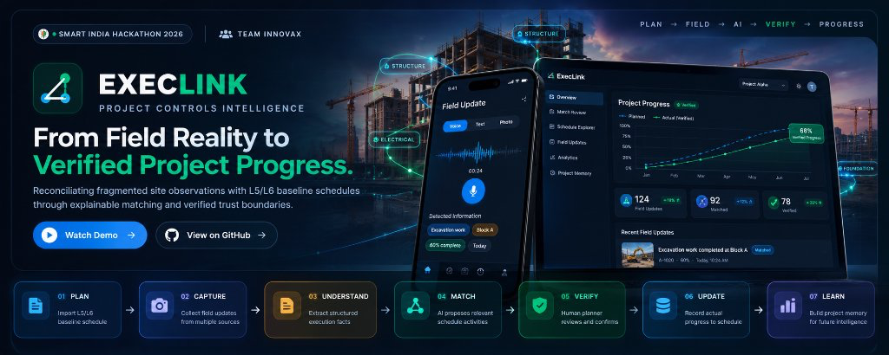
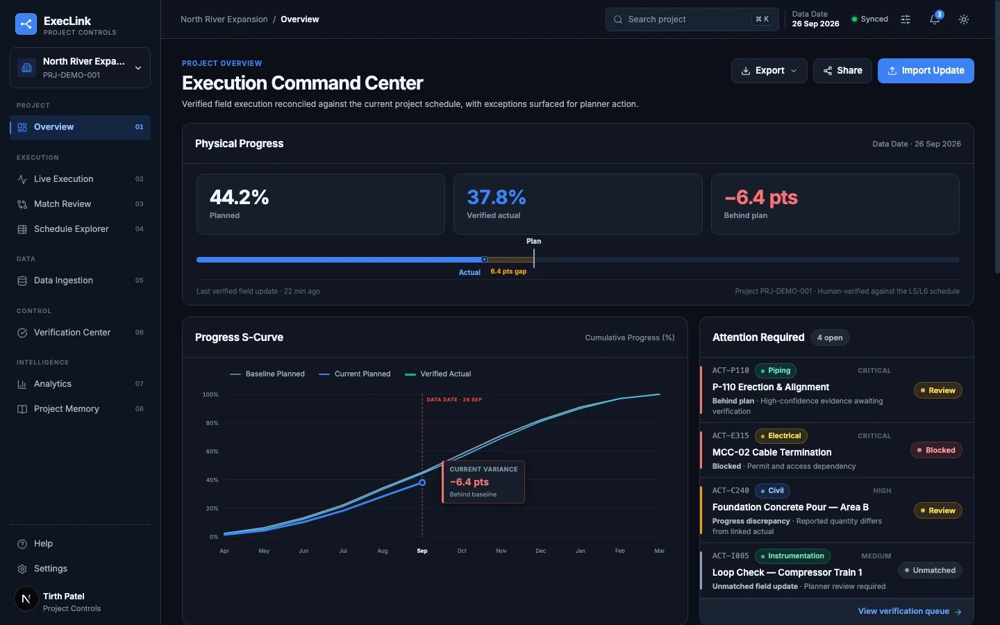
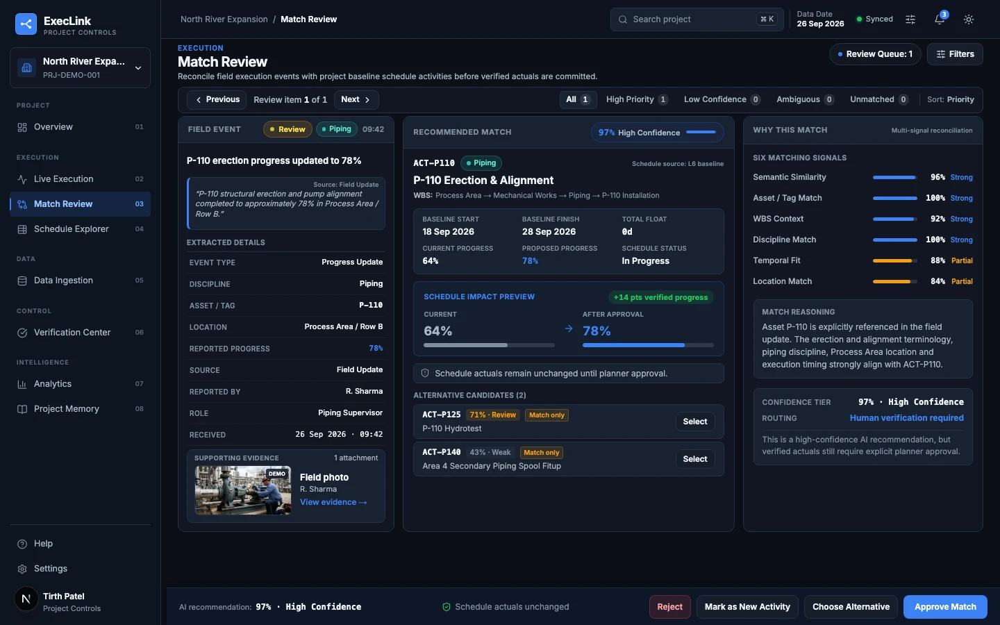
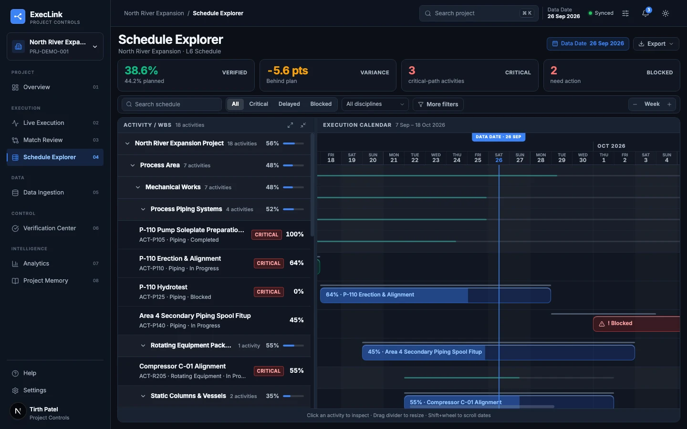
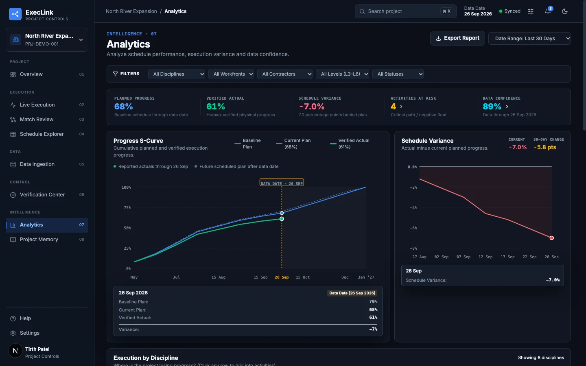
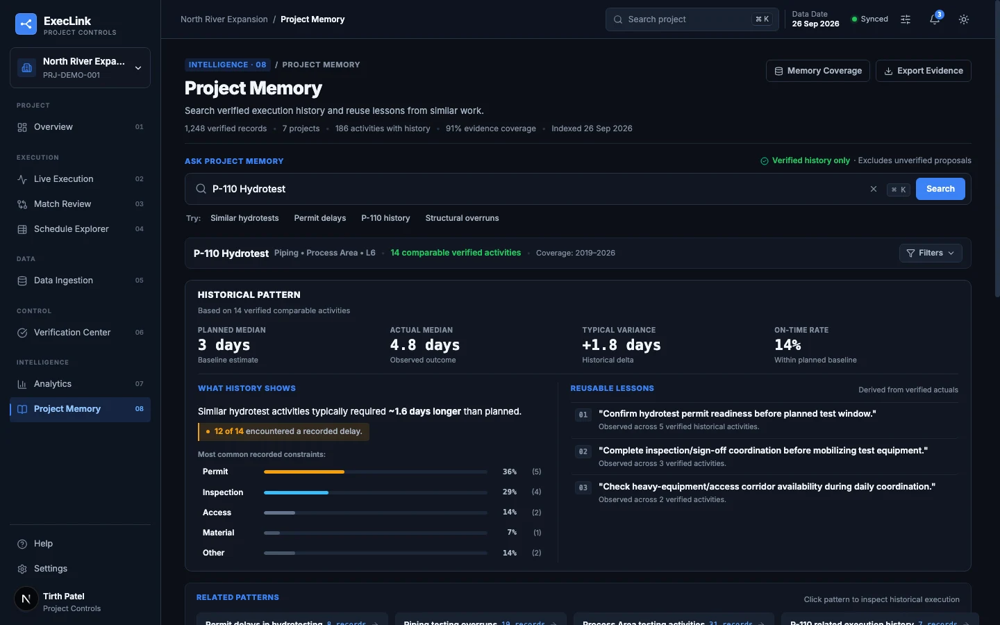
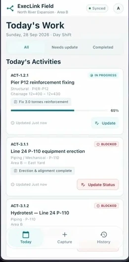
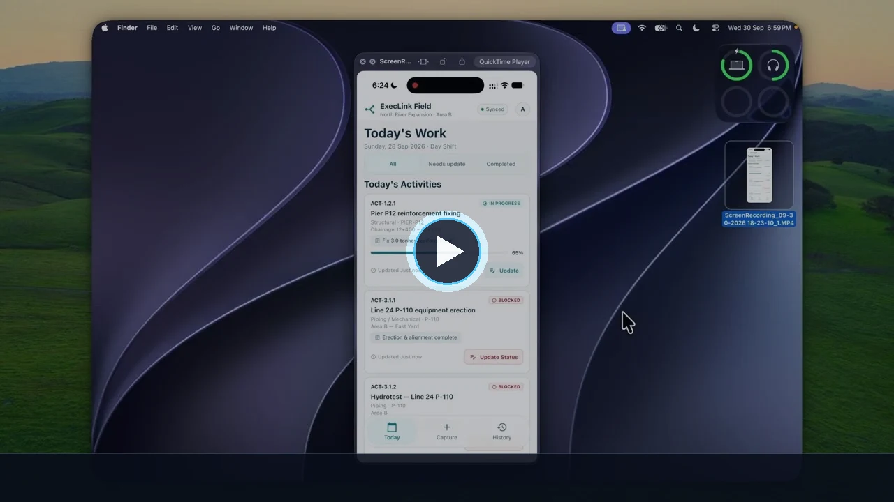
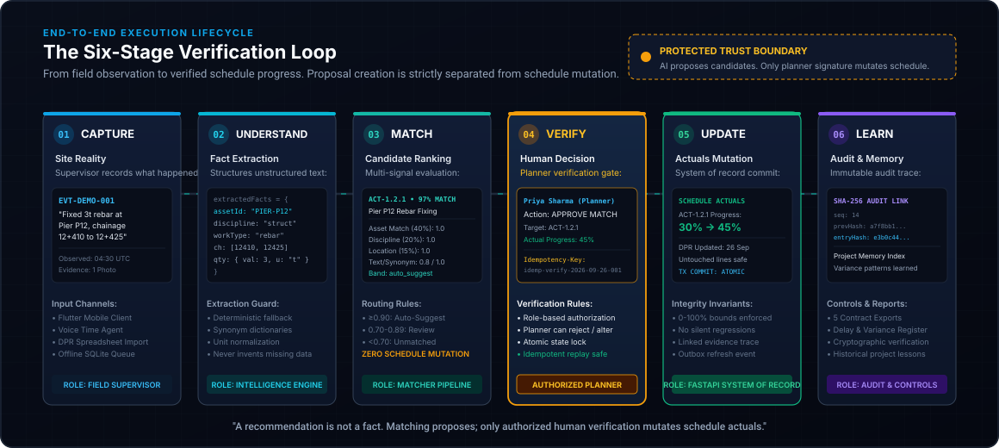
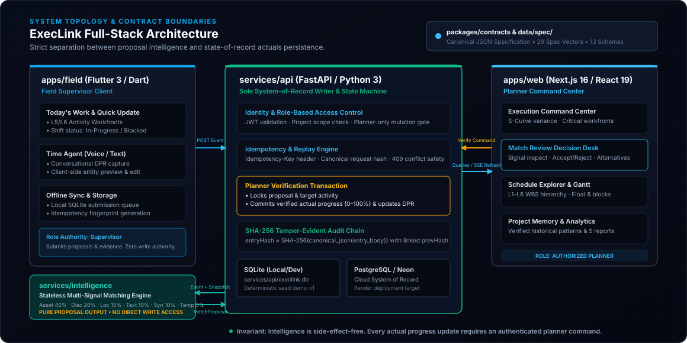

# ExecLink

<p align="center">
  
</p>

<p align="center">
  <strong>From Field Reality to Verified Project Progress.</strong><br>
  <em>Reconciling messy site execution with baseline infrastructure schedules through explainable AI matching and protected human verification boundaries.</em>
</p>

<p align="center">
  <a href="#see-execlink-in-action"></a>
  <a href="#meet-execlink"></a>
  <a href="#how-execlink-works"></a>
  <a href="#system-architecture"></a>
  <a href="#quick-start"></a>
  <a href="docs/PRODUCT.md"></a>
</p>

<p align="center">
  
  
  
  
  
  
  
  
</p>

---

## The Problem: Planning vs. Reality

Large infrastructure projects (highways, metros, process plants, power grids) are planned using complex hierarchical schedules with thousands of L4–L6 activities in Oracle Primavera P6 or Microsoft Project.

Yet daily execution unfolds on physical job sites where supervisors communicate through:
- Fragmented Daily Progress Reports (DPRs)
- Conversational voice notes and messaging
- Hand-written shift diaries and site spreadsheets
- Photos, inspection reports, and permit slips

**These field observations almost never cite the exact schedule activity ID.** 

A supervisor reports: *"Fixed 3 tonnes of rebar at Pier P12, chainage 12+410 to 12+425."*  
They do not report: `ACT-1.2.1: PRJ-DEMO-001/CIV/STR/P12/REBAR`.

Project controls engineers spend hours cross-referencing messy field notes with Gantt charts. Progress updates lag by days or weeks, delay claims go unrecorded, and schedule variance is discovered only after milestones have slipped.

### The ExecLink Core Invariant

> **AI proposes. The planner verifies. Only verified information becomes trusted project progress.**

ExecLink bridges the gap between field reality and schedule controls. It ingests messy field evidence, extracts structured engineering facts, ranks explainable candidate matches against L5/L6 activities, and surfaces them to an authorized planner. Automation **never** silently mutates project actuals.

---

## Table of Contents

- [Meet ExecLink](#meet-execlink)
- [See ExecLink in Action](#see-execlink-in-action)
- [How ExecLink Works: The 6-Stage Loop](#how-execlink-works-the-6-stage-loop)
- [Real Example: Field Reality to Verified Progress](#real-example-field-reality-to-verified-progress)
- [Product Capabilities](#product-capabilities)
- [Explainable Intelligence (Matcher)](#explainable-intelligence-not-blind-automation)
- [Trust, Verification & Auditability](#trust-verification--auditability)
- [System Architecture](#system-architecture)
- [Technology Stack](#technology-stack)
- [Repository Structure](#repository-structure)
- [Quick Start](#quick-start)
- [Scope & Non-Goals](#current-scope--non-goals)
- [Team & Origin](#team--project-origin)

---

## Meet ExecLink

ExecLink consists of a desktop **Planner Control Center** (Next.js 16) and a mobile **Field Execution App** (Flutter 3), backed by a deterministic FastAPI system of record.

### 1. Execution Command Center (Planner Overview)
Reconciles physical progress against the baseline plan, computes live S-curve variance, surfaces critical-path activities at risk, and queues unverified field observations.

<p align="center">
  
</p>

### 2. Match Review Decision Interface
The heart of planner control. Planners inspect original field evidence, view multi-signal explainability scores, evaluate schedule impact before approval, and accept, reject, or reassign candidate matches.

<p align="center">
  
</p>

### 3. Schedule Explorer & L6 Gantt
Interactive WBS tree and execution calendar linking verified progress directly to activities, highlighting float, critical-path activities, and field-reported blockages.

<p align="center">
  
</p>

### 4. Progress Analytics & Schedule Variance
Tracks baseline vs. current plan vs. verified actual progress over time, discipline-level progress health, and activity risk indicators.

<p align="center">
  
</p>

### 5. Project Memory & Historical Intelligence
Indexes past verified executions, delays, and permit bottlenecks across projects. Planners can query historical variance patterns before committing new schedules.

<p align="center">
  
</p>

### 6. Mobile Field Application (Supervisor Experience)
Flutter-based field client for site supervisors: daily activity checklists, one-touch progress and blockage reporting, conversational **Time Agent** for voice/text updates, and an offline SQLite queue for low-connectivity job sites.

<p align="center">
  
</p>

---

## See ExecLink in Action

Watch our complete end-to-end walkthrough showing real field capture, entity extraction, multi-signal candidate ranking, planner verification, and cryptographic audit trace generation:

<p align="center">
  <a href="https://youtu.be/g7M5uL5cztw" target="_blank" rel="noopener noreferrer">
    
  </a>
</p>

<p align="center">
  <a href="https://youtu.be/g7M5uL5cztw"><strong>▶ Click here to watch the full ExecLink Demonstration on YouTube (720p HD)</strong></a>
</p>

---

## How ExecLink Works: The 6-Stage Loop

ExecLink operates through a continuous, auditable six-stage lifecycle:

<p align="center">
  
</p>

```
01 CAPTURE    ──> 02 UNDERSTAND ──> 03 MATCH     ──> [ TRUST BOUNDARY ] ──> 04 VERIFY    ──> 05 UPDATE     ──> 06 LEARN
Site DPR /         Structured        6-Signal Match      Human Planner          Authorized        L5/L6 Progress    SHA-256 Chain,
Voice Transcript   Entity Tuple      Proposal            Decision Gate          Signature         Mutation          Memory & Reports
```

| Stage | Subsystem | Action | Invariant / Boundary |
|:---|:---|:---|:---|
| **01 — Capture** | `apps/field` | Supervisor reports site observation via mobile UI, voice transcript, or DPR spreadsheet. | Stored as raw `ExecutionEvent` with immutable timestamp and reporter ID. |
| **02 — Understand** | `services/intelligence` | Tokenizes text, extracts normalized asset tags, discipline, location chainage, quantities, and work types. | Deterministic extraction fallback guarantees zero reliance on external model availability. |
| **03 — Match** | `services/intelligence` | Evaluates candidates against active schedule snapshot using 6 configurable signals. | **Pure proposal output.** The matching engine has no database write access to schedule actuals. |
| **04 — Verify** | `apps/web` + `services/api` | Authorized planner reviews raw evidence, signal breakdown, and candidate options. Approves or rejects. | **Protected Trust Boundary.** Only an authenticated user with `role: planner` can sign a verification. |
| **05 — Update** | `services/api` | Backend executes atomic transaction: locks proposal, mutates activity progress (0–100%), updates daily DPR. | Atomic, idempotent execution. Replaying with the same key returns the existing result without re-mutating. |
| **06 — Learn** | `services/api` | Appends SHA-256 audit entry, emits outbox event for dashboard refresh, indexes into Project Memory. | Cryptographic chain linkage guarantees tamper-evident history. |

---

## Real Example: Field Reality to Verified Progress

Here is how an authentic fixture from our deterministic demo (`EVT-DEMO-001`) flows through ExecLink:

### 1. Raw Field Input
Supervisor Asha Rao submits a site update from Pier P12:
```text
"Fixed 3 tonnes of rebar at Pier P12, chainage 12+410 to 12+425."
Evidence: 1 inspection photo attached (ATT-DEMO-001)
```

### 2. Extracted Engineering Facts
The extraction engine structures the unstructured text into a canonical schema:
```json
{
  "assetId": "PIER-P12",
  "discipline": "structural",
  "workType": "rebar-fixing",
  "location": { "kind": "chainage", "alignment": "BL", "start": 12410, "end": 12425, "unit": "m" },
  "quantity": { "value": 3, "unit": "t" },
  "keywords": ["pier", "rebar", "fixed"]
}
```

### 3. Multi-Signal Match Scoring
The matcher compares the extracted facts against the pinned baseline schedule snapshot:

| Signal | Config Weight | Score | Contribution | Explanation |
|:---|:---:|:---:|:---:|:---|
| **Asset Identifier** | 40% | `1.00` | `+0.400` | Exact asset identifier match (`PIER-P12` == `PIER-P12`) |
| **Discipline** | 20% | `1.00` | `+0.200` | Exact discipline match (`structural` == `structural`) |
| **Location Chainage** | 15% | `1.00` | `+0.150` | Event chainage [12+410, 12+425] is inside activity [12+400, 12+430] |
| **Text Similarity** | 10% | `0.80` | `+0.080` | Shared token similarity (`pier`, `reinforcement`) |
| **Work Type Synonym** | 10% | `1.00` | `+0.100` | Versioned synonym dictionary match (`rebar-fixing` ~ `reinforcement`) |
| **Temporal Proximity** | 5% | `0.80` | `+0.040` | Observation falls within planned execution window |
| **Final Score** | **100%** | **0.97** | **0.970** | **Band: `auto_suggest` (Score ≥ 0.90)** |

### 4. Planner Decision & System-of-Record Mutation
Planner Priya Sharma reviews `MPR-DEMO-001` in Match Review. The evidence is verified, and the planner confirms progress at 45%:

```http
POST /api/v1/projects/PRJ-DEMO-001/proposals/MPR-DEMO-001/verify
Authorization: Bearer <planner-jwt>
Idempotency-Key: idemp-verify-2026-09-26-001
Content-Type: application/json

{
  "decision": "verified",
  "targetActivityId": "ACT-1.2.1",
  "verifiedProgress": 45,
  "notes": "Verified against site photo ATT-DEMO-001."
}
```

### 5. Verified Outcome
- `ACT-1.2.1` progress updates from **30% → 45%** in the system of record.
- Untouched line `ACT-1.2.2` remains untouched at **0%**.
- The `2026-09-26` Daily Progress Report reflects the 45% progress with linked evidence.
- A new SHA-256 audit entry (`entryHash: 3f18e...`) is committed linking to the previous block.

---

## Product Capabilities

### 📱 Field Execution (`apps/field`)
- **Daily Shift View:** Supervisors see today's assigned L5/L6 activities, planned work quantities, and current statuses.
- **Time Agent (Voice & Text):** Conversational assistant allowing site personnel to speak or type site notes with live extracted preview before submission.
- **One-Touch Quick Update:** Fast progress and blockage reporting directly from the workfront.
- **Evidence Management:** Uploads photos, tickets, and site documentation with metadata isolation.
- **Offline SQLite Queue:** Submissions are queued and fingerprinted locally when working in tunnels or remote locations, replaying safely upon reconnection.

### 🧠 Execution Intelligence (`services/intelligence`)
- **Deterministic Extraction:** Rule-based and synonym-driven entity parser that operates with zero hallucination.
- **Multi-Signal Matching:** Evaluates candidates across asset, discipline, location, text, synonym, and temporal signals.
- **Explainable Ranking:** Every candidate contains an itemized score breakdown and plain-English rationale.
- **Threshold Routing:** Segregates proposals into `auto_suggest` (≥0.90), `review` (0.70–0.89), and `unmatched` (<0.70).
- **Graceful Fallback:** Automatically activates `mode: deterministic_fallback` if semantic or model infrastructure is unreachable.

### 🎯 Planner Control (`apps/web`)
- **Match Review Desk:** Three-pane decision workspace with side-by-side evidence preview, candidate ranking, and schedule impact simulation.
- **Candidate Reassignment:** Planners can reassign events to alternative activities, reject false matches, or flag brand-new untracked tasks.
- **Verification Center:** Prioritized queue of unresolved exceptions, blocked activities, and low-confidence proposals.
- **Idempotent Mutation:** Guarantees network retries or duplicate button clicks never record duplicate progress increments.

### 📊 Project Controls & Governance
- **Execution Command Center:** Executive dashboard with planned vs. verified physical progress and live S-curve variance.
- **Schedule Explorer:** Interactive Gantt chart displaying WBS hierarchy, critical-path flags, and float.
- **5 Contract Exports:** Deterministically generates:
  1. *Schedule Variance Report*
  2. *Verification Audit Log*
  3. *Match Quality & Latency Report*
  4. *Delay & Blockage Register*
  5. *Discipline Progress Breakdown*
- **Project Memory:** Searchable intelligence repository indexing historical delay patterns, permit bottlenecks, and discipline overruns.

---

## Explainable Intelligence, Not Blind Automation

ExecLink avoids black-box decision making. Every match proposal is derived from explicit, version-controlled parameters defined in `data/demo/matching-config.json` and `services/intelligence/config.py`:

```json
{
  "configVersion": "match-config-v1",
  "engineVersion": "matcher-v1",
  "weights": {
    "asset": 0.40,
    "discipline": 0.20,
    "location": 0.15,
    "text": 0.10,
    "workType": 0.10,
    "temporal": 0.05
  },
  "thresholds": {
    "autoSuggest": 0.90,
    "review": 0.70
  },
  "tieBreaker": [
    "score:desc",
    "activityWbs:asc",
    "activityId:asc"
  ]
}
```

### Signal Computation Rules
1. **Asset Match (40%):** Exact normalized asset identifier comparison.
2. **Discipline Match (20%):** Validates engineering discipline or recognized interface relationships (e.g., civil ↔ structural).
3. **Location Match (15%):** Geometric overlap ratio of event chainage against activity bounds.
4. **Text Similarity (10%):** Tokenized lexical and semantic overlap over descriptions and keywords.
5. **Work Type Synonym (10%):** Versioned synonym dictionary mapping field terminology to schedule activities.
6. **Temporal Proximity (5%):** Proximity score decaying with distance from planned start/finish windows.

### Confidence Routing Bands
- **`auto_suggest` (Score ≥ 0.90):** Strong multi-signal alignment. Surfaces to planner as the primary recommended action.
- **`review` (0.70 ≤ Score < 0.90):** Ambiguous or partial match. Surfaces multiple candidates for planner discretion.
- **`unmatched` (Score < 0.70):** No schedule activity adequately matches. Routed to the unmatched queue to prevent false linkages.

> **Important:** Even in the `auto_suggest` band, **ExecLink never approves automatically.** The planner must inspect and confirm every proposal.

---

## Trust, Verification & Auditability

ExecLink is engineered around the principle of cryptographic auditability and zero-trust automation.

### Role Separation
- **`field_supervisor`:** Authorized to capture execution events and attach evidence. Has **zero authority** to verify proposals or update schedule actuals.
- **`planner`:** Authorized to verify proposals, adjust progress percentages, and commit changes to the system of record.
- **`project_manager` / `viewer`:** Read-only access to progress dashboards, reports, and audit trails.

### Cryptographic SHA-256 Audit Chain
Every verification creates an immutable, tamper-evident audit record stored in the system of record:

$$\text{entryHash} = \text{SHA-256}\left(\text{canonical\_json}(\text{entryBody})\right)$$

The audit chain ensures:
- `entryBody` includes `sequence`, `projectId`, `occurredAt`, `actorId`, `actorRole`, `action`, `entityType`, `entityId`, `payload`, and `previousHash`.
- `previousHash` links to the predecessor entry (or 64 zeros for sequence 1).
- Canonical JSON rules (`packages/contracts/src/canonical.ts`) guarantee byte-identical hashing across Python, Dart, and TypeScript.
- Any attempt to modify a past row or alter progress invalidates the entire subsequent chain.

### Idempotency Protection
All mutation endpoints mandate the `Idempotency-Key` HTTP header. The server atomically computes:
$$\text{requestHash} = \text{SHA-256}\left(\text{canonical\_json}(\{\text{method}, \text{path}, \text{body}\})\right)$$
Replaying the same command returns the cached response with zero duplicate mutations.

---

## System Architecture

ExecLink enforces strict architectural boundaries across the stack:

<p align="center">
  
</p>

### Integration Authority
`packages/contracts` and `data/spec/` serve as the single source of truth:
- **Canonical Contracts:** TypeScript types and portable JSON Schemas (`packages/contracts/schemas/*.schema.json`).
- **Normative Canonicalization:** `src/canonical.ts` defines deterministic JSON serialization rules across Python and Dart.
- **Spec Vectors:** 29 committed canonicalization vectors in `data/spec/canonicalization-vectors.json`, validated on every test run.

---

## Technology Stack

ExecLink uses an enterprise stack built for performance, reliability, and offline capability:

| Layer | Technologies | Purpose |
|:---|:---|:---|
| **Web Dashboard** | **Next.js 16**, **React 19**, **TypeScript 5**, **Tailwind CSS 4** | Planner control center, execution command desk, Match Review UI, and interactive Gantt schedule explorer. |
| **Mobile Client** | **Flutter 3**, **Dart 3**, **Riverpod**, **SQLite (sqflite)** | Field supervisor application for iOS/Android/Web, voice Time Agent, and offline queueing. |
| **Backend API** | **FastAPI**, **Python 3**, **Uvicorn**, **Pydantic 2** | Sole system of record writer, RBAC enforcement, verification state machine, and SHA-256 audit chaining. |
| **Intelligence** | **Python 3**, **NumPy** | Multi-signal matching engine, deterministic synonym dictionaries, and tokenized entity extractor. |
| **Persistence** | **PostgreSQL** (Neon cloud target), **SQLite** (local & offline) | Relational storage for schedules, DPRs, events, and audit logs. |
| **Contracts** | **JSON Schema**, **TypeScript**, **Node.js** | Single integration authority ensuring cross-language type safety and canonical digest consistency. |

---

## Repository Structure

```text
ExecLink/
├── apps/
│   ├── web/                    # Planner control center (Next.js 16 + React 19)
│   └── field/                  # Field supervisor application (Flutter 3 + Riverpod)
├── services/
│   ├── api/                    # System of record & verification state machine (FastAPI)
│   └── intelligence/           # Multi-signal matching & fact extraction engine
├── packages/
│   ├── contracts/              # Canonical contracts, JSON Schemas, & canonicalization spec
│   └── design-tokens/          # Shared visual tokens across web and mobile
├── data/
│   ├── demo/                   # Deterministic fixtures (schedules, DPRs, proposals)
│   └── spec/                   # Cross-language canonicalization vectors for audit verification
├── docs/                       # Product requirements, architecture, and matching specs
├── qa/                         # Automated QA scripts and regression suites
└── scripts/                    # Development launchers, health preflights, and contract validators
```

---

## Quick Start

### Prerequisites
- **Node.js:** `v20.0.0` or newer (Node 22 / 24 tested)
- **Python:** `3.11` to `3.14`
- **Flutter:** `3.24+` (for mobile field app)
- **Git**

### 1. Clone the Repository
```bash
git clone https://github.com/Tirth-byte/ExecLink..git
cd ExecLink.
```

### 2. Install Root & Contract Dependencies
```bash
npm install
```

### 3. Verify Contracts & Canonical Digests
Run the automated contract check (370+ assertions across 13 JSON Schemas, demo fixtures, and SHA-256 digest vectors):
```bash
npm test
```

### 4. Reset & Seed the Deterministic Demo Database
Initialize the local SQLite system of record with fixture `demo-v1` (PRJ-DEMO-001, North River Expansion):
```bash
python3 -m services.api.verification_seed --database services/api/execlink.db --seed-version demo-v1
```

### 5. Launch the Backend API
Start the FastAPI server on port 8000:
```bash
./scripts/dev.sh
```

In a separate terminal, run the development preflight check to verify health and authentication:
```bash
./scripts/check-dev.sh
```
*Expected output: API process PASS · Health PASS · Authentication PASS.*

### 6. Launch the Web Application
Start the Planner Control Center:
```bash
npm --prefix apps/web run dev
```
Open **[http://localhost:3000](http://localhost:3000)** in your browser.

### 7. Launch the Field Mobile Application (Optional)
To run the Flutter field app on an iOS simulator or connected device:
```bash
./scripts/run-field.sh
```
Or serve as a web client:
```bash
cd apps/field && flutter run -d web-server --web-port 8085 --dart-define="EXECLINK_API_BASE_URL=http://127.0.0.1:8000/api/v1"
```

### Demo Accounts
- **Planner:** `priya@execlink.demo` / `Demo123!` (Full verification authority)
- **Supervisor:** `asha@execlink.demo` / `Demo123!` (Field capture authority)

---

## Current Scope & Non-Goals

ExecLink is built with engineering rigor and honesty. We clearly distinguish implemented capabilities from future enhancements:

| In Scope (Phase 1 Baseline) | Out of Scope / Explicit Non-Goals |
|:---|:---|
| ✅ Capture of unstructured text, voice, and DPR rows | ❌ Autonomous schedule mutation without human approval |
| ✅ Deterministic extraction & 6-signal candidate ranking | ❌ Generative LLM rewriting of project milestones |
| ✅ Interactive planner verification & candidate reassignment | ❌ Direct real-time bidirectional Primavera API sync *(uses imported schedule snapshots)* |
| ✅ Idempotent progress updates (0–100% bounds enforced) | ❌ Automated multi-project resource or cost optimization |
| ✅ Cryptographic SHA-256 audit chain linkage | ❌ Silent background progress regressions |
| ✅ 5 Contract report exports (Variance, Audit, Quality, Delays, Disciplines) | ❌ Machine learning retraining on unverified proposals |
| ✅ Offline SQLite submission queue with conflict safety | ❌ Multi-tenant enterprise SSO (uses role-based JWT) |

---

## Team & Project Origin

### Built for Smart India Hackathon 2026
**Team INNOVAX**

ExecLink was engineered to address one of the most persistent bottlenecks in modern infrastructure management: **the loss of fidelity between what planners schedule on paper and what actually happens on site.**

---

<p align="center">
  <sub>ExecLink © 2026 Team INNOVAX. Designed for robust, explainable infrastructure project controls.</sub>
</p>
